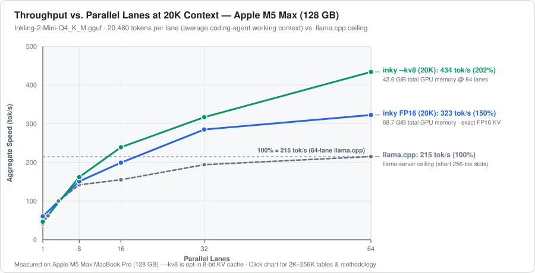

Fast local inference for [**Inkling 2 Mini**](https://thinkingmachines.ai/news/inkling-2-mini/) on Apple silicon.

With **inky**, you can:

* Run Thinking Machines' Inkling 2 Mini on an M5 Mac, from the LM Studio GGUF
* Decode on a single lane at **76 tok/s** at 20K context (**1.6x** faster than llama.cpp's 47 tok/s) and **95–106 tok/s** at short context (**2.3x–2.6x** faster than 41 tok/s), with **4,186–4,531 tok/s** prompt prefill
* Scale across **64 parallel 20K-token lanes** to **431 tok/s** with `--kv8` (**2.75x** faster than llama.cpp's 157 tok/s FP16 ceiling in **43.6 GiB** vs. 77.8 GiB GPU memory, and **2.26x** faster than llama.cpp `q8_0`'s 190 tok/s in 51.7 GiB), **530–578 tok/s** at 2K context, and **322 tok/s** at 42K context
* Match llama.cpp argmaxes (worst KL <= 0.01) across CI's checked reference positions: 58/58 on short-prompt decode, 24/24 after a 2380-token long-prompt prefill, and 58/58 on short-prompt decode steps
* Serve many coding-agent tasks at once over HTTP from one process (`--kv8` on by default in `scripts/inky-fleet-serve.sh`), sharing cached prompt prefixes in memory (**6.8x** lower KV at 16×8K) and on SSD. See [performance](docs/PERFORMANCE.md), [design](docs/DESIGN.md), and [roadmap](docs/ROADMAP.md).

This is a fork of [erisinky](https://github.com/Eriskii/erisinky) by Eris.

Built by Glenn Fiedler ([yojimbo](https://github.com/mas-bandwidth/yojimbo), [netcode](https://github.com/mas-bandwidth/netcode)), Rowan Claude and Eris.

For more information, please ask your AI to [read the docs](docs/README.md), or see [docs/CONTRIBUTING.md](docs/CONTRIBUTING.md) for building and running the validation suite with or without an M5 Mac.
